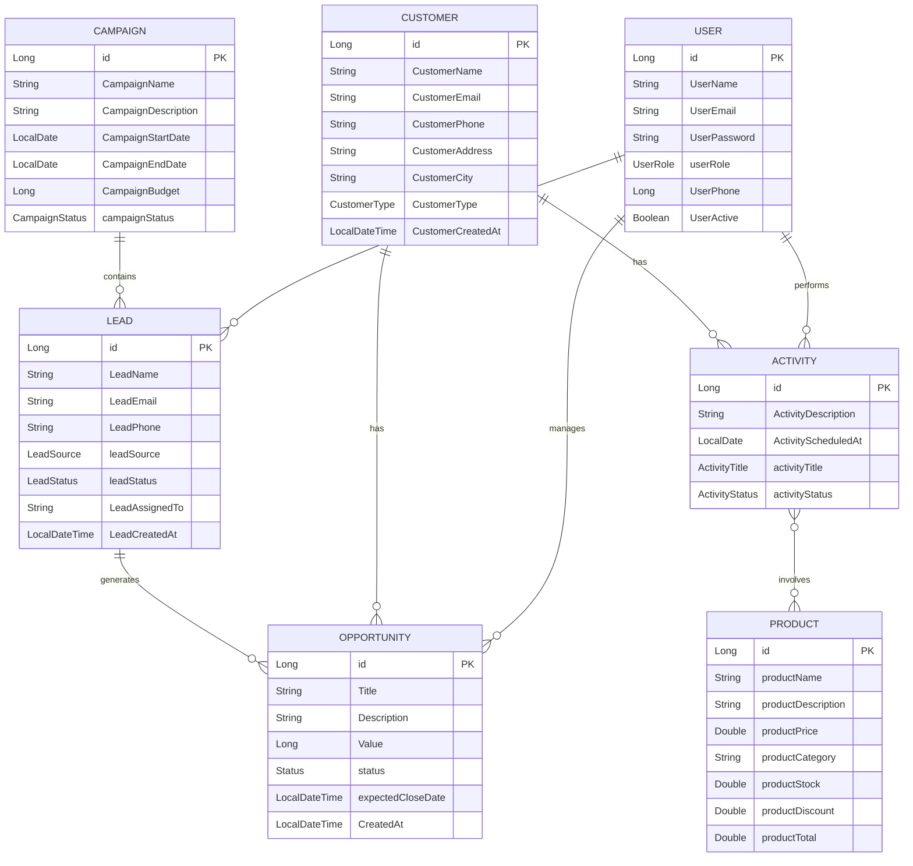
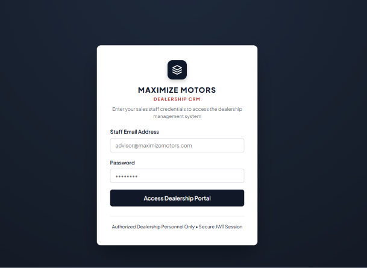
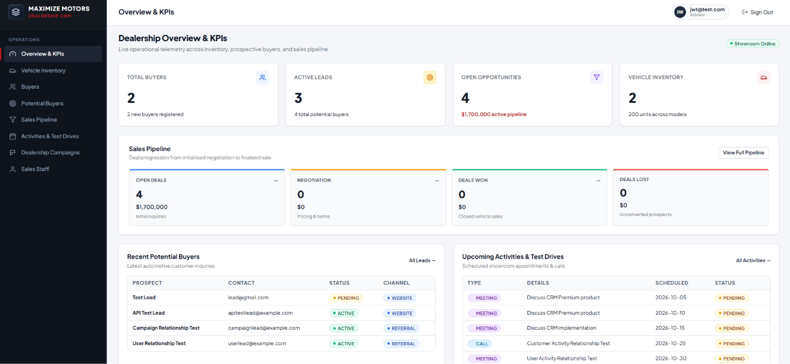
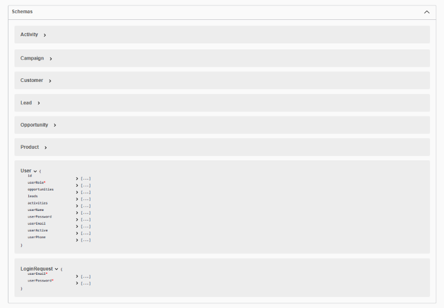
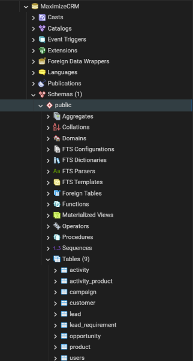

# MaximizeCRM

[](https://github.com/Agrima0408/MaximizeCRM/actions/workflows/maven-build.yml)

MaximizeCRM is a Customer Relationship Management application for managing customers, leads, opportunities, campaigns, activities, and products through a secure REST API and a web frontend.

## Live Deployment

| Component | Link |
|---|---|
| **Live Application (Frontend)** | [https://maximizecrm.onrender.com](https://maximizecrm.onrender.com) |
| **Backend API** | [https://maximizecrm-backend.onrender.com](https://maximizecrm-backend.onrender.com) |
| **GitHub Repository** | [Agrima0408/MaximizeCRM](https://github.com/Agrima0408/MaximizeCRM) |
| **Project Report** | [MaximizeCRM IEEE Report](MaximizeCRM_IEEE_Report.pdf) |

The frontend is deployed on Render and communicates with the separately deployed Spring Boot backend.

---

## Features

- User registration and login with JWT-based authentication
- CRUD operations for customers, leads, opportunities, campaigns, activities, and products
- Linked CRM data: users manage leads and opportunities, campaigns contain leads, and leads generate opportunities
- Input validation and global exception handling
- Swagger/OpenAPI documentation for API documentation and testing
- PostgreSQL database integration
- Responsive web-based frontend

---

## Tech Stack

| Layer | Technologies |
|---|---|
| Backend | Java 17, Spring Boot 3.2.5, Spring Web, Spring Data JPA, Spring Security, Jakarta Bean Validation, JWT, Lombok, Maven |
| Database | PostgreSQL 17, Hibernate / JPA |
| Frontend | HTML, CSS, JavaScript |
| Deployment | Render |
| Tools | IntelliJ IDEA, Git, GitHub, GitHub Actions, Swagger / OpenAPI |

---

## Project Structure

```text
MaximizeCRM
│
├── .github/
│   └── workflows/
│       └── maven-build.yml
│
├── database/
│   ├── database.yml
│   ├── Project-PPT
│   └── Project-Report
│
├── MaximizeCRM Backend/
│   ├── src/
│   ├── pom.xml
│   └── mvnw
│
├── MaximizeCRM Frontend/
│   └── Frontend files
│
├── screenshots/
│   ├── login.png
│   ├── dashboard.png
│   ├── swagger.png
│   └── database.png
│
├── MaximizeCRM_IEEE_Report.pdf
└── README.md
```

---

## Entity Relationship (ER) Diagram

The following diagram represents the main entities and relationships in the backend.



### Entity Relationships

| Relationship | Type |
|---|---|
| User → Lead | One-to-Many |
| User → Opportunity | One-to-Many |
| User → Activity | One-to-Many |
| Customer → Opportunity | One-to-Many |
| Customer → Activity | One-to-Many |
| Campaign → Lead | One-to-Many |
| Lead → Opportunity | One-to-Many |
| Activity ↔ Product | Many-to-Many |

The `Activity` and `Product` relationship uses the `activity_product` join table.

**Note:** `UserRole` is part of the User entity. Role-based authorization is not currently enforced by the security configuration. The application uses JWT authentication for protected endpoints.

---

## Authentication & Security

MaximizeCRM uses JWT-based authentication with Spring Security.

### Login

```http
POST /api/auth/login
```

A successful login returns a JWT token, which is sent with protected requests:

```http
Authorization: Bearer <JWT_TOKEN>
```

The security configuration provides:

- Public user registration and login endpoints
- CRM endpoints protected by valid JWT authentication
- Stateless session management
- Unauthorized responses for invalid or missing authentication

---

## API Documentation

Swagger/OpenAPI is integrated into the backend for API documentation and testing.

**Local Swagger URL:**

```text
http://localhost:8081/swagger-ui/index.html
```

**Deployed backend:**

[https://maximizecrm-backend.onrender.com](https://maximizecrm-backend.onrender.com)

If Swagger UI is enabled on the deployed backend, it can be accessed at:

[https://maximizecrm-backend.onrender.com/swagger-ui/index.html](https://maximizecrm-backend.onrender.com/swagger-ui/index.html)

### API Modules

| Module | Purpose |
|---|---|
| Authentication | Login and JWT generation |
| Users | User registration and management |
| Customers | Customer information |
| Leads | Lead management and tracking |
| Opportunities | Sales opportunity management |
| Campaigns | Campaign management |
| Activities | CRM activities |
| Products | Product catalogue |

Refer to the backend controllers and Swagger documentation for the exact endpoint mappings.

---

## Build & CI

The backend uses Maven and includes the Maven Wrapper.

```bash
# Linux / macOS
./mvnw clean verify

# Windows
.\mvnw.cmd clean verify
```

The project does not yet have an automated unit or integration test suite, so `clean verify` confirms that the backend builds, not that application behaviour is tested.

The GitHub Actions workflow (`.github/workflows/maven-build.yml`) runs on pushes to `main` and on pull requests targeting `main`. It checks out the repository, sets up Java 17, caches Maven dependencies, and runs `clean verify`.

---

## Run the Backend Locally

### Prerequisites

- Java 17
- PostgreSQL
- Git

### 1. Clone the repository

```bash
git clone https://github.com/Agrima0408/MaximizeCRM.git
cd MaximizeCRM
```

### 2. Create the PostgreSQL database

Create a database named:

```text
MaximizeCRM
```

The database structure is documented in `database/database.yml`.

### 3. Configure the backend

Open:

```text
MaximizeCRM Backend/src/main/resources/application.properties
```

Configure your local PostgreSQL credentials and JWT secret. Do not commit real passwords or secrets.

Example configuration:

```properties
spring.datasource.url=jdbc:postgresql://localhost:5432/MaximizeCRM
spring.datasource.username=postgres
spring.datasource.password=${DB_PASSWORD}

jwt.secret=${JWT_SECRET}

spring.jpa.hibernate.ddl-auto=update
server.port=8081
```

### 4. Start the backend

From inside the `MaximizeCRM Backend` folder:

```bash
# Linux / macOS
./mvnw spring-boot:run

# Windows
.\mvnw.cmd spring-boot:run
```

The backend runs locally at:

```text
http://localhost:8081
```

---

## Frontend

The frontend is located in the `MaximizeCRM Frontend` folder.

To run the application locally:

1. Start the Spring Boot backend.
2. Open the frontend's main HTML file in a browser.
3. Ensure the frontend API configuration points to the local backend at `http://localhost:8081`.

For the deployed application, visit:

**[https://maximizecrm.onrender.com](https://maximizecrm.onrender.com)**

---

## Screenshots

### Login



### Dashboard / Main Interface



### Swagger API Documentation



### Database



---

## Database Documentation

The `database` folder contains the database documentation:

```text
database/
├── database.yml
├── Project-PPT
└── Project-Report
```

`database.yml` documents the PostgreSQL database and the main tables used by the application:

```text
users
product
opportunity
lead_requirement
lead
customer
campaign
activity_product
activity
```

---

## Author

**MaximizeCRM – Customer Relationship Management System**

Developed using Java, Spring Boot, PostgreSQL, HTML, CSS, and JavaScript.